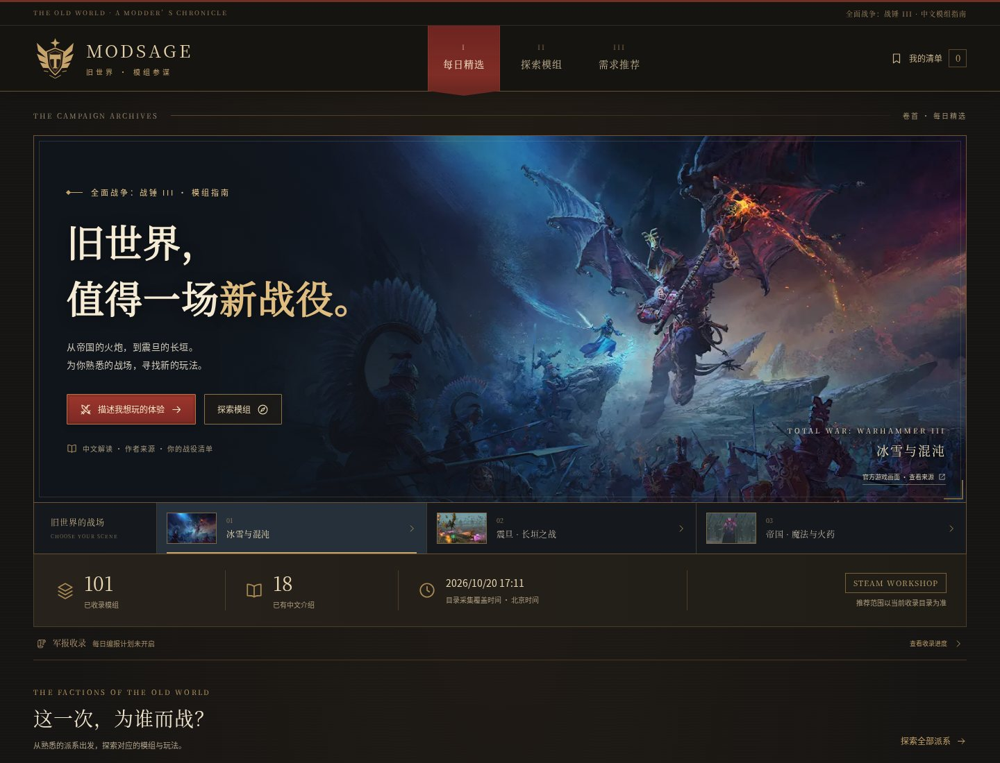

# ModSage · 战锤模组参谋

**旧世界，值得一场新战役。**

面向《全面战争：战锤 3》中文玩家的 Mod 发现、解读与需求推荐项目。
使用真实 Steam Workshop 元数据，保留来源和采集时间；把中文介绍、游戏内汉化与兼容性声明分别处理。

[](https://github.com/volcano-code/ModSage/actions/workflows/ci.yml)



上图为 2026-10-21 连接已有真实目录的运行截图；首次克隆仍从空目录开始，通过下方命令自行同步。另见 [移动端](docs/screenshots/home-v3-mobile.jpg)、[帝国场景](docs/screenshots/home-v3-empire.jpg)、[派系入口](docs/screenshots/factions-v3-desktop.jpg)。主视觉使用官方 Steam 商店宣传画和游戏截图；来源、完整性与权利说明见 [官方画面清单](docs/game-media.md)。这些氛围素材与具体 Mod 的 Workshop 预览严格区分。

## 当前版本：v0.3 官方游戏画面与可评测检索

首页可切换冰雪与混沌、震旦长垣、帝国艾斯佩斯三组官方画面，并从帝国、震旦、基斯里夫入口直接搜索对应模组。探索、需求推荐与清单页也使用官方场景横幅；猩红军旗、古铜铁框与羊皮纸内容区组成统一的战役档案界面。数据来自实际接口，装饰内容不充当 Mod 证据。

| 已实现的能力 | 实际边界 |
| --- | --- |
| Workshop 详情与公开合集读取、认证检索适配器 | QueryFiles 需要自行配置有效 Steam API key；无 key 详情路径已经做小规模实测 |
| 有上限的公共页面发现 | 明确的备用路径，不能保证全站完整覆盖；不会绕登录、验证码或限流 |
| 内容快照、哈希去重、指标记录、同步任务结果 | 保存真实源数据，失败不会刷新成功同步时间 |
| 目录、筛选、详情与来源证据 | 首次启动为空，需执行真实同步；没有默认演示 Mod |
| LangGraph 有界推荐流程与运行记录 | `engine` 区分规则/模型需求解析，`retrieval.method` 单独记录本次实际检索方法 |
| 中英术语、字段加权 BM25 与匹配证据 | 默认完全本地运行；派系、排除项及必要语言条件先过滤，再召回 |
| 可选向量索引、精确余弦检索与 RRF 融合 | 需要单独配置服务并手动回填；已做 provider mock 与数据库验证，尚无真实向量质量验收，不是 pgvector/ANN 或神经重排 |
| 冻结检索评测与 CI 报告 | 42 条真实来源短文本、28 条需求；开发判断标签，不能替代独立人工标注与用户实验 |
| 可配置模型的需求解析、中文介绍生成 | 不附带模型 key；真实模型连通性需在配置后验证，错误会明确退化 |
| 中文原文摘录 | 标记为来源中文，不冒充机器翻译；不据此认定游戏内汉化 |
| 日报构建与读取 | 使用收录目录的时间与可用指标；不伪造历史增长率 |
| 每日目录刷新 worker、持久化任务和恢复 | 上海时区调度、幂等入队、原子领取、租约与重试；需启动独立 worker，默认关闭自动排队 |
| 公开同步状态 | 分别显示任务、计划和最近 worker 心跳；部分完成不冒充完整成功 |
| 浏览器本机清单、前置检查 | 无跨设备账户同步；未知前置和未知兼容性会明确提示 |
| SQLite 本地启动、PostgreSQL Compose、CI | 后续仍需真实连续运行、生产部署与规模压测 |

Next.js + React + TypeScript / FastAPI + SQLAlchemy / LangGraph。
详见 [架构与边界](docs/architecture.md)、[API 契约](docs/API_CONTRACT.md)、[检索配置](docs/retrieval.md)、[冻结评测](docs/retrieval-evaluation.md)、[每日刷新](docs/daily-refresh.md)、[数据实测](docs/data-access-report.md)、[验证记录](docs/verification.md)。

## 快速启动

需要 Python 3.12+、Node.js 22+。从仓库根目录执行：

```bash
python3 -m venv .venv
.venv/bin/python -m pip install --require-hashes -r apps/api/requirements-dev.lock
.venv/bin/python -m pip install --no-deps -e 'apps/api[dev]'
npm --prefix apps/web ci
.venv/bin/python -m modsage.cli init-db
```

分别在两个终端启动：

```bash
.venv/bin/python -m uvicorn modsage.main:app --host 127.0.0.1 --port 8000
```

```bash
npm --prefix apps/web run dev
```

打开 <http://localhost:3000>。API 文档位于 <http://localhost:8000/docs>。
网页通过同源 `/api/v1` 白名单代理访问 API，默认上游为 `http://127.0.0.1:8000`；可在 `apps/web/.env.local` 中设置 `API_BASE_URL`。

Python 依赖由 `apps/api/uv.lock` 及导出的带哈希 requirements 锁定，前端使用 `package-lock.json`。开发、CI 和容器使用相同的锁定依赖；升级时统一更新锁文件。

### 导入真实数据

```bash
# 已知 Workshop ID：使用官方详情 API。
.venv/bin/python -m modsage.cli sync --ids 2976080822

# 明确选择公共页面有限发现，再通过官方详情 API 导入。
.venv/bin/python -m modsage.cli discover --public --limit 50 --sort updated

# 配置 MODSAGE_STEAM_API_KEY 后，可改用官方认证发现。
# .venv/bin/python -m modsage.cli discover --limit 50 --sort updated

# 以当前目录生成日报。
.venv/bin/python -m modsage.cli digest
```

示例 ID 仅用于演示导入方式，并非对其功能、版本或兼容性的推荐。
无数据和外部来源失败时，页面会明确显示状态。生产数据库及原文快照位于忽略目录，不提交到 Git。

### 每日刷新任务

先执行一个有上限的真实刷新任务：

```bash
.venv/bin/python -m modsage.cli enqueue-refresh --key first-refresh --source public
.venv/bin/python -m modsage.cli worker --once
.venv/bin/python -m modsage.cli jobs --limit 10
```

相同 key 不会重复入队；任务和结果保存在数据库。自动刷新需要在根目录 `.env` 中设置 `MODSAGE_REFRESH_ENABLED=true`，明确选择 `MODSAGE_REFRESH_SOURCE=public` 或配置 key 后使用 `api`，然后持续运行 `.venv/bin/python -m modsage.cli worker`。默认计划为北京时间每日 08:00，默认不调用模型。恢复、重试、部分完成语义及全部配置见 [每日刷新运行说明](docs/daily-refresh.md)。

### 可选模型配置

在根目录 `.env` 或进程环境中设置：

```dotenv
MODSAGE_LLM_BASE_URL=https://your-provider.example/v1
MODSAGE_LLM_MODEL=your-accessible-model
MODSAGE_LLM_API_KEY=your-private-key
```

地址需提供兼容 `POST /chat/completions` 的服务。项目不会替你提供或猜测真实 key。
配置后运行 `.venv/bin/python -m modsage.cli enrich --help`，按批次生成中文介绍。
模型生成结果必须保留证据引用；界面仍将游戏内中文与兼容性独立显示为未知，除非存在对应事实。

### 可选混合检索

默认 `MODSAGE_RETRIEVAL_MODE=bm25`，无需模型服务。需要验证语义通道时，在已有真实目录的基础上配置独立的 embeddings 服务：

```dotenv
MODSAGE_EMBEDDING_BASE_URL=https://your-provider.example/v1
MODSAGE_EMBEDDING_MODEL=your-embedding-model
MODSAGE_EMBEDDING_API_KEY=your-private-key
# 仅当服务支持且需要固定输出维度时填写。
MODSAGE_EMBEDDING_DIMENSIONS=
MODSAGE_RETRIEVAL_MODE=hybrid
```

```bash
.venv/bin/python -m modsage.cli embedding-status
.venv/bin/python -m modsage.cli embed --limit 20 --batch-size 8
.venv/bin/python -m modsage.cli embedding-status
```

服务需兼容 `POST /embeddings`。回填会把标题、标签和作者介绍前段发给所配置的服务；混合推荐另发送一次需求文本。默认不会自动回填，同一数据库应串行运行 `embed`。来源变化或模型配置变化时，旧向量不再参与语义检索；未配置、无有效索引或提供方失败时明确回退 BM25。详情见 [预算、索引版本与回退](docs/retrieval.md)。

### 可复现检索评测

```bash
.venv/bin/python scripts/evaluate_retrieval.py --check --output artifacts/retrieval-evaluation.json
```

无需数据库、Steam key 或模型调用；使用仓库内冻结的 42 条短文本和 28 条需求，包含 3 条无答案需求。标签和数据校验和固定，指标均为真实脚本输出：

| 方法 | Recall@5 | nDCG@5 | MRR@5 | 无答案正确数 |
| --- | ---: | ---: | ---: | ---: |
| 旧关键词基线 | 0.9200 | 0.8753 | 0.8733 | 3/3 |
| BM25 | 0.9200 | 0.8900 | 0.9000 | 3/3 |

两种方法在本集已标注的排除案例中均为 0 次违规；BM25 没有提高该集的 Recall@5，两个中文意译需求仍未召回。该结果只说明这组冻结短文本上的表现，不代表全量 Workshop、真实向量检索或用户满意度。[评测方法与逐条结果](docs/retrieval-evaluation.md) 记录了开发/回归拆分、指标分母、失败案例和标签局限。

### Docker Compose

```bash
cp .env.example .env
docker compose up --build -d
docker compose exec api python -m modsage.cli discover --public --limit 50
docker compose exec api python -m modsage.cli digest

# 如需每日自动刷新，先在 .env 开启刷新计划并明确选择来源，再启动 worker。
docker compose --profile automation up --build -d
```

Compose 使用 PostgreSQL，并将所有端口绑定到本机。默认数据库口令仅用于本地开发；公共部署需替换秘密、配置 HTTPS、备份及容量限制。
代码仓库不包含公开托管实例，也不会因为提交代码自动部署线上服务。

## 验证

```bash
.venv/bin/python -m pytest apps/api/tests
.venv/bin/python -m ruff check apps/api scripts
.venv/bin/python -m ruff format --check apps/api scripts
.venv/bin/python scripts/evaluate_retrieval.py --check
npm --prefix apps/web run lint
npm --prefix apps/web run typecheck
npm --prefix apps/web run build
```

浏览器集成测试需要 Chromium，并使用独立的 `data/modsage-e2e.db`。其中的合成条目明确标为 E2E fixture，不会导入默认应用数据库。

```bash
cd apps/web
npx playwright install chromium
npm run test:e2e
```

CI 包含后端与冻结评测、真实 PostgreSQL 的并发入队/领取与租约恢复，以及向量 JSON 读写、模型命名空间隔离、幂等回填与过期回退检查；另有前端构建、Chromium 浏览器集成、完整 Docker Compose 和可选 worker 启动检查。CI 不调用真实 Steam 或模型服务。请以 Actions 中具体提交的结果为准。

## 目录

| 路径 | 内容 |
| --- | --- |
| `apps/api` | API、数据模型、Steam 适配器、推荐图、中文生成、CLI 和测试 |
| `apps/web` | Next.js 页面、公开 API 代理、本机清单和浏览器测试 |
| `scripts` | 真实来源探测、隔离 E2E 初始化、PostgreSQL 验证 |
| `eval` | 冻结的真实短文本语料、需求与相关性判断、可重现结果 |
| `docs` | 接口契约、架构、数据实测与交付记录 |
| `.github/workflows` | CI |

## 下一阶段验收

1. 配置实际可用的 Steam QueryFiles key，验证认证发现、分页和字段覆盖。
2. 配置模型并完成中文生成的真实 canary 与人工来源核验。
3. 扩大独立标注的中文需求集，实测向量/混合检索质量、延迟与成本，再决定 ANN 索引和重排方案。
4. 将推荐请求扩展为可恢复的后台任务，增加 SSE、用户账户与通知幂等。
5. 记录连续运行、更新覆盖、失败补偿和实际成本。

ModSage 是独立玩家项目，与 Valve、Creative Assembly 和 Games Workshop 无隶属关系。Mod 内容归其作者及相应权利人所有，保留 Steam 与作者原始链接。
